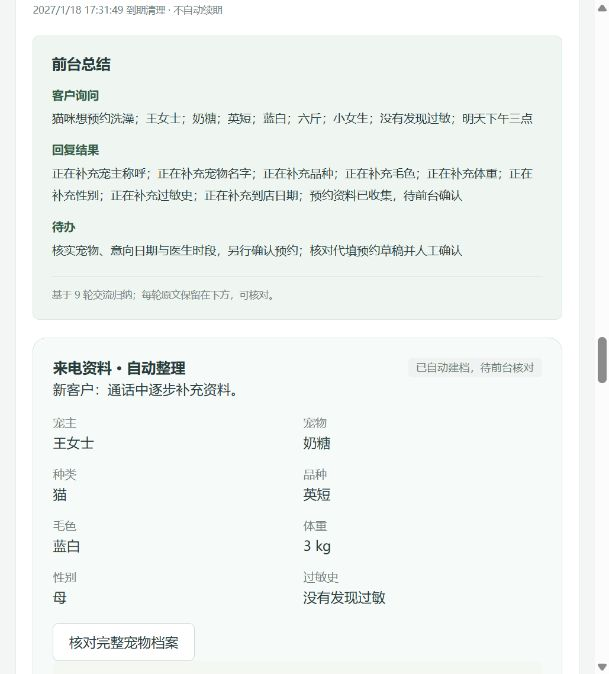
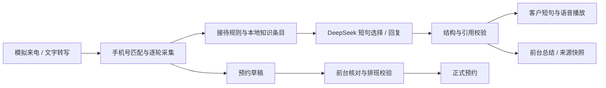

# zzy · 宠物医院运营与 AI 电话接待 Demo

一个可本地运行、可验证业务闭环的全栈作品。围绕「来电咨询 → 客户建档 → 预约确认 → 接诊开单 → 收费与回访」，将业务管理、AI 辅助接待和人工审核连接起来。

**技术：** Node.js · SQLite · 原生 JavaScript · DeepSeek Chat Completions · Web Audio / SpeechSynthesis
**版本：** 3.4.1 · **验证：** 23 项自动化测试通过 · 无第三方运行依赖

## 核心亮点

- **电话接待有业务落点：** 模拟振铃与接听，按手机号匹配本门店宠物；新客逐步建档、自动提取预约意向，前台最终确认。
- **回复简短且有依据：** 每轮只补问一项，客户听到短句，前台查看引用原文、版本、来源链接与回复时快照。模型返回需要校验，不合规则回退。
- **五项关键资料：** 只追加品种、毛色、体重、性别、过敏史；已知信息不重复问。支持斤 / 公斤转换，未知体重不会写成 0。其他健康信息留给前台按需补录。
- **业务规则在后端：** 检查医生排班、请假、停诊、跨店与连续时段冲突；收费使用服务端价格，资金操作采用事务和幂等控制。
- **角色与医院隔离：** 院长、前台、医生、宠主视图，员工账号与门店授权；接口校验租户、角色和记录范围。



## 快速运行

需要 Node.js **22.13 或更新版本**（开发验证使用 Node.js 26）。解压后在项目文件夹打开终端：

```sh
npm start
```

打开 [本地演示](http://127.0.0.1:4318/)。Windows 也可以双击 `启动Demo.cmd`。

无需安装 npm 依赖。首次启动自动生成虚构宠物、预约和电话案例；不配置 AI 密钥，也能运行规则回复与固定语音演示。数据库保存在本地 `data/`，服务仅监听 `127.0.0.1`。

可直接选择「青禾宠物医疗 / 院长或前台」。员工演示账号为 `admin`、`frontdesk`、`doctor`，演示密码均为 `Demo2026!`；它们是公开的本地测试账号。

## 五分钟体验

1. 以「前台」进入「电话智能接待」，选择「新客疫苗 · 逐步建档」或「老客美容 · 自动填档」案例。
2. 点击「模拟电话拨入」体验振铃、接听；开启朗读，或直接播放自然语音示例。
3. 使用虚构资料提问「猫咪想预约洗澡」，逐轮回答姓名、宠物名字与五项资料，再给出到店时间。
4. 查看通话总结、收集资料与逐条回复依据；在完整档案中核对电话补充。
5. 结束通话后，补齐医生、时间与预计占位时长，人工确认正式预约。美容内容与实际耗时仍须到店确认。
6. 切换院长查看排班、会员资产、收银、对账与报表，继续体验接诊到收费的闭环。

疫苗场景会先了解年龄、近期健康和接种经历；是否适合接种由医生评估。急症或诊疗请求转人工，不由模型给出处方。

## 功能范围

| 模块 | 当前实现 |
| --- | --- |
| AI 电话接待 | 12 个案例、模拟来电、短句回复、资料采集、来源快照、总结与人工跟进 |
| 客户与宠物 | 手机号匹配、多宠选择、新客关联建档、完整资料编辑、口述资料待核对 |
| 预约排班 | 服务时长、连续占位、医生排班、请假、停诊、跨店冲突与人工确认 |
| 诊疗与库存 | 接诊状态、病历、服务开单、库存调整和预警 |
| 会员与财务 | 充值、折扣、计次卡、部分收款、退款、欠费、逐笔对账、报表与 CSV |
| 连锁与权限 | 多医院数据隔离、门店授权、员工账号、跨店业务、统一服务价格 |

## AI 与语音如何实现



知识库为人工整理的公开 AAHA / AAFP 指南摘要及院内业务规则，带来源与版本；当前使用规则匹配，不宣称实现向量检索或实时联网诊疗。接待采集由状态机控制，DeepSeek 在审核过的候选短句中选择，避免多问、编造与自动承诺预约。

复制 `.env.example` 为 `.env`，自行配置：

```dotenv
AI_ENABLED=true
AI_CHAT_URL=https://api.deepseek.com/chat/completions
AI_MODEL=deepseek-chat
AI_API_KEY=填入自己的密钥
```

密钥只由服务端读取，API 状态接口不返回密钥。未配置、超时或校验失败时回退到规则回复。

**声音：** 常用短句播放预先合成的晓晓中文语音，其余回复尝试本机 SpeechSynthesis 分句朗读。DeepSeek 负责文字，项目尚未接入商业实时 TTS、ASR 或真实电话线路。固定语音文件随包提供，无需借用作者的任何密钥。接口结构见 [API 说明](docs/API.md)。

## 工程结构与验证

```text
server.js             HTTP、会话、SQLite 与宠物档案接口
domain.js            排班、会员资金、对账、员工与门店权限
calls.js              通话、总结、来源快照、人工确认、保留期
receptionist.js       单轮问询状态机与口语短句
booking-draft.js      预约意向提取和草稿
pet-profile.js        档案字段、未知值与输入校验
ai-provider.js        DeepSeek 适配、超时回退与引用校验
knowledge/            公开资料摘要与院内规则
public/               工作台页面与语音演示资源
tests/                业务、权限、AI 适配和接待回归测试
```

```sh
npm test
```

23 项测试覆盖建档到收费、事务与幂等、门店和角色权限、连续排班、对账、电话溯源、自然月保留期、五项逐步问询、未知值与人工核对。测试使用独立临时数据库；外部模型使用模拟 HTTP 服务验证适配边界，不要求评审者提供密钥。

## 作品定位与数据说明

本项目是 **AI 辅助开发的全栈业务原型**，用于展示需求拆解、业务建模、接口联调、可追溯 AI 接待与验证思路。可以作为简历项目和面试演示，不将 Demo 描述成已商用产品，不虚构上线用户、业务收益或性能指标。

- 电话振铃、支付、退款、短信为演示；资金流水在本地保存，没有真实资金划转。
- 通话原文、总结和来源快照保留三个自然月，到期清理；客户业务档案与已确认预约独立保留。
- 压缩包不包含作者的 `.env`、本地数据库、历史通话、私人目录或 Git 历史。种子人物和号码均为虚构演示输入。
- 生产化仍需真实线路 / ASR / TTS、支付平台与回调验签、正式身份认证、数据库迁移、备份及部署监控。

**简历表述参考：** 基于 Node.js 与 SQLite 实现宠物医院运营 Demo，串联建档、排班、接诊和收费流程；接入 DeepSeek 构建短句电话接待，支持资料自动采集、来源追溯与预约人工确认，并通过 23 项接口和业务回归测试验证关键规则。
